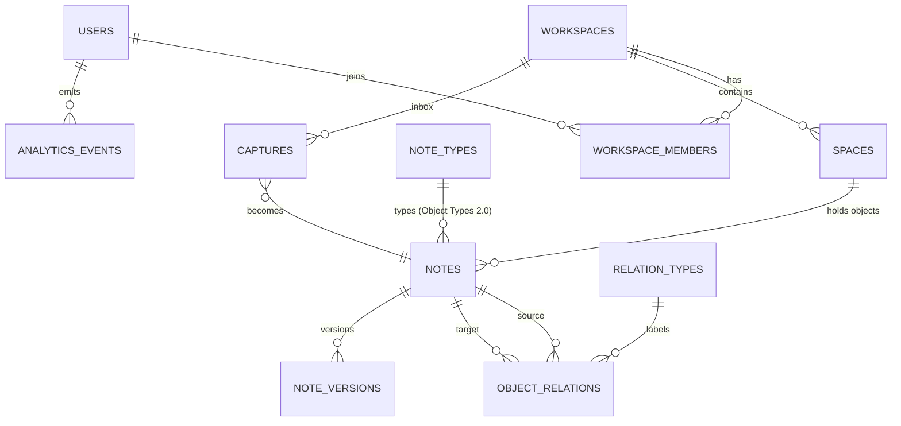
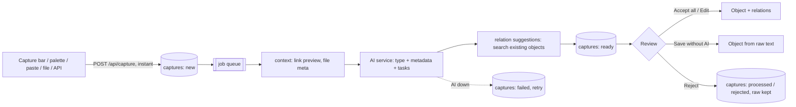

# Inkwell — Product Architecture

> "Capture anything. Inkwell connects it."

This document describes where Inkwell V2 is going (an AI-powered personal and team knowledge workspace) and how the existing codebase gets there without a rewrite. It is based on a full audit of the repository as of 2026-11-22 (`origin/main` @ `29c01c5`).

Companion documents: [TECHNICAL_ROADMAP.md](TECHNICAL_ROADMAP.md), [DATABASE_MIGRATION_PLAN.md](DATABASE_MIGRATION_PLAN.md), [UX_REDESIGN_PLAN.md](UX_REDESIGN_PLAN.md).

---

## 1. Audit summary

### 1.1 What exists today

| Area | Implementation | Verdict |
| --- | --- | --- |
| Frontend | React 18 + Vite + Tailwind + Radix/shadcn + lucide, React Router v6, axios client (`src/lib/api.ts`), contexts for auth/theme/settings/reminders/filters | **Keep** |
| Backend | One Express file, `server.ts` (~4.7k lines, ~150 routes) under `/api` | **Keep, split gradually** into `server/` modules |
| Database | Drizzle ORM, `src/db/schema.ts`; PostgreSQL via `pg` in production, embedded PGlite in dev/self-host. DDL is applied at boot by `initDatabaseSchema()` (`CREATE TABLE IF NOT EXISTS` + `ALTER … ADD COLUMN IF NOT EXISTS`) | **Keep**, add a migration ledger |
| Auth | Email/password (bcrypt) + Google OAuth; JWT access (1 d) and refresh (7 d) tokens in httpOnly `Secure` cookies; Bearer fallback from `localStorage` | Keep; harden in Phase 3 |
| Notes | `notes` row = title, markdown `content` (also carries drawings, outlines, mindmaps, timeslots, reminders and comments as fenced blocks), `date` + `period` (day/week/month), `tags[]`, `people[]`, `location_id`, `note_type_id`, `custom_fields`, `area_ids[]`, `drive_files[]`, pin/archive, "encryption", `embedding`, `ai_summary` | **Becomes the Object table** |
| Note types | `note_types` with a JSON field schema (`dropdown`, `boolean`, `number`, `text`, `datetime`, `datetime_range`, `calculation`) rendered by `CustomFieldsRenderer` | **Becomes Object Types 2.0** |
| Versions | `note_versions`, one row per save, restore endpoint | Keep |
| Comments | Embedded in note markdown (`<!-- inkwell:comments -->`) | Keep for now; move to a table in Phase 4 (collaboration) |
| Wikilinks / backlinks | `[[Title]]` parsed **in the browser** (`MarkdownView`, `GraphView`, `NoteDetail`) against *all* notes fetched client-side | Replace the source of truth with server-side relations |
| Areas | `areas` (hierarchical, archivable) + `notes.area_ids` | Keep as cross-cutting topic buckets inside a Space |
| Tags / people / locations / categories / stickers / phrases / item_groups | Per-user tables; tags and people are extracted from `#tag` / `@name` on save | Keep |
| Kanban | `type_card` notes + `kanban_columns` | Keep (this is the Task object) |
| Reminders | Parsed from ```reminder blocks into `reminders` | Keep |
| Files | Multer in memory (25 MB) → base64 row in `files` **and** a copy in `DATA_DIR/uploads`; served by capability URL `/api/files/:id` with safe inline types and a sandbox CSP | Keep the data; put behind a storage abstraction (Phase 3) |
| AI | `src/lib/embeddings.ts`: Gemini `text-embedding-004` embeddings, with a deterministic hash-vector fallback; cosine similarity computed in Node (the `embedding` column was converted to `TEXT`) | Move behind a provider-independent AI service |
| Maps | Google Maps + Leaflet/OSM, GPS, Nominatim geocoding proxy | Keep; keep light until capture and AI are solid |
| Integrations | Google Calendar (read-only) and Google Drive (metadata) with AES-256-GCM encrypted refresh tokens | Keep; generalise into `integrations` (Phase 5) |
| PWA | Manifest + service worker (no private data cached) | Keep |
| Tests | None runnable (`test_reports/` are stale JSON); only `tsc --noEmit` | Add a `node:test` suite (no new dependency) |

### 1.2 Blockers for a SaaS

1. **Single-tenant data model.** Every table is keyed by `user_id`. There is no workspace, membership or role concept, so nothing can be shared and nothing can be billed per team.
2. **Full-table scans in request handlers.** `GET /api/notes` loads *every* note of the user and filters in JavaScript; semantic search parses every embedding in Node. This is fine at hundreds of notes and breaks at tens of thousands.
3. **Relations live only in markdown.** Backlinks are recomputed in the browser from the whole note list. There are no typed relations, so "person works on project" or "paper cites paper" cannot be expressed or queried.
4. **No migration ledger.** Schema changes are idempotent `ALTER`s executed on every boot. There is no record of which data backfills ran, so one-off data migrations cannot be made safely.
5. **AI is synchronous and provider-locked.** Embeddings are computed inline in `POST/PUT /notes` (a slow Gemini call blocks the save) and the code imports `@google/genai` directly.
6. **No background jobs, quotas, usage records, billing, audit log or rate limiting.**
7. **Monolithic `server.ts`** mixes HTTP, validation, business rules and SQL, which makes authorization hard to review.

### 1.3 Security, scale, performance and data-integrity risks

| # | Risk | Severity | Plan |
| --- | --- | --- | --- |
| S1 | **Note "encryption" is not encryption.** `src/lib/crypto.ts` stores a salted SHA-256 hash of a password; the content is stored and served in plaintext, the hash is sent to the client (`password_hash` in every note payload) and verified there. Anyone with DB or API access reads the note. | High (misleading) | Phase 1: rename to **"Parola kilidi"** in the UI and docs. Phase 3: optional real client-side encryption (AES-GCM, PBKDF2/Argon2id key derivation, no plaintext keys), with documented effects on search/AI/versions/recovery. Stop sending `password_hash` once verification moves server-side. |
| S2 | Uploaded files are reachable by anyone who knows the URL (no auth on `GET /api/files/:id`). IDs are random (64 bits + time), so this is a capability URL, not an open hole, but links leak through sharing/referrers. | Medium | Phase 3: signed, expiring URLs from the storage abstraction; keep old URLs working for the owner. |
| S3 | No rate limiting on login, register, AI or link-preview endpoints. | Medium | Phase 1 adds a small in-memory limiter for new capture/search endpoints; Phase 3 moves to a shared store and covers auth. |
| S4 | Error bodies include `err.message` (leaks SQL/driver details). | Low–Medium | New endpoints return generic messages; existing ones are cleaned up as routes move into modules. |
| S5 | Uploads are validated only by size; MIME type comes from the client. | Medium | Phase 3: magic-byte sniffing, allow-list, per-plan size limits, AV hook. |
| S6 | Bearer token in `localStorage` (XSS ⇒ token theft) alongside httpOnly cookies. | Medium | Phase 3: cookie-only sessions with CSRF protection, session table for revocation. |
| S7 | Authorization is per-route `eq(userId)` checks, easy to forget. | High once teams exist | Phase 3: a single access layer (`canRead/canWrite(object)`) used by every query; tests per role. |
| P1 | O(n) scans for list, search, calendar counts and backlinks. | High at scale | Server-side relations (Phase 1), SQL filtering + pagination and a real `vector` column with an HNSW index on Postgres (Phase 2). |
| P2 | Base64 copy of every file inside Postgres doubles storage and bloats backups. | Medium | Phase 3: object storage is the primary copy; the base64 column becomes a migration source only (never deleted before verification). |
| D1 | Content-embedded structures (comments, reminders) mean a bad regex edit can corrupt data. | Medium | Every write path keeps creating a version; tests cover the parsers. |
| D2 | No backup/restore drill beyond the JSON export. | Medium | Phase 3: scheduled `pg_dump` + uploads sync, restore runbook. |

### 1.4 Parts to reuse as-is

- Markdown/drawing/outline/mindmap editors and viewers, timeslot and reminder blocks, comments.
- `note_types` field schema and `CustomFieldsRenderer` → object properties.
- `note_versions` → object versions.
- Link preview fetcher with SSRF protection (`getLinkPreview`) → smart-paste URL metadata.
- `getISOWeekNumber`, period helpers, calendar panel → Today/daily notes.
- Areas → topic structure inside a Space.
- Google integration token encryption (`encryptSecret`) → future `integrations` table.

---

## 2. Target domain model



### 2.1 Object = the existing `notes` row

We **do not** create a parallel `objects` table. A second table would force a dual-write period across ~40 endpoints, the editors, kanban, calendar, map, graph and the backup format. Instead the `notes` table *is* the object table:

| Object attribute | Column |
| --- | --- |
| id | `note_id` (unchanged, so every URL, wikilink and backup keeps working) |
| title, content | `title`, `content` |
| type | `note_type_id` → `note_types` (NULL = plain note) |
| properties | `custom_fields` (values keyed by property id) |
| tags, people | `tags`, `people` (+ `tags`/`people` tables) |
| location | `location_id` (+ Location objects later) |
| relations / backlinks | `object_relations` (new) |
| attachments | `files` referenced from content, `drive_files` |
| timestamps | `created_at`, `updated_at`, `date`, `period` |
| owner | `user_id` |
| workspace, space | `workspace_id`, `space_id` (new, nullable, backfilled) |
| visibility | `visibility` (new: `private` \| `space` \| `workspace`) |
| versions | `note_versions` |
| AI metadata | `ai_summary`, `embedding`, `ai_meta` (new JSONB: detected type, confidence, extracted entities, model, provider) |
| capture source | `source` (new JSONB: kind, url, author, site, capture_id) |

The API keeps the `/api/notes` shape. New `/api/objects/...` endpoints are additive views on the same rows. A later rename to `objects` (if ever wanted) would be a view swap, done only after verification, with a rollback plan (see the migration plan).

### 2.2 Object Types 2.0 = `note_types`

- System types (rows with `user_id IS NULL`, seeded idempotently): Note, Card/Task, Daily note, Idea, Project, Person, Meeting, Event, Book, Research paper, Article, Quote, Reference, Location, File.
- Each type carries a property schema in `fields` using the existing field kinds, so the existing renderer and editor handle every type **without code per type**. Example — Research Paper: Authors, Year, DOI, Journal, Method, Findings, Reading status (dropdown), Rating (dropdown 1–5).
- Users create their own types in *Ayarlar → Nesne tipleri* (the existing `NoteTypeManager`).
- Later phases add property kinds `url`, `rating`, `multi_select`, `relation` and `file`; renderer support lands with the kind.

### 2.3 Relations

`object_relations (source_id, target_id, relation_type, origin, status)`, with `relation_types (key, label, inverse_label, symmetric)`.

- Built-in types: `links_to` / "bağlantı veren" (wikilink), `related_to` (symmetric), `works_on` / "üzerinde çalışan", `attended` / "katılımcı", `cites` / "atıf yapan", `part_of` / "içerir", `mentions`, `about`, `located_at`, `derived_from`, `captured_on`. Users can add custom types.
- `origin`: `wikilink` (derived, kept in sync on every save), `manual`, `template`, `capture`, `ai`.
- `status`: `active` or `suggested` (AI suggestions await user review and never count as real links until accepted).
- **Wikilinks keep working**: on every create/update the server parses `[[…]]` outside code fences, resolves by title, slug or id within the owner's objects, and reconciles `origin = wikilink` rows. A one-off backfill builds them for existing notes.
- **Backlinks** are the incoming side of active relations, read with one indexed query.

### 2.4 Workspaces and Spaces

- `workspaces (workspace_id, name, kind = personal|team, owner_id, plan)`; `workspace_members (workspace_id, user_id, role = owner|admin|editor|commenter|viewer)`.
- Every user gets exactly one personal workspace (backfilled), with a default Space "Kişisel".
- `spaces (space_id, workspace_id, name, description, color, icon, archived)`; objects carry `space_id`.
- **Authorization rule (server-side only):** a request can read an object if the caller is a member of the object's workspace with a role that grants read, *and* the object is in a space the member can see. Phase 1 still enforces the stricter rule `notes.user_id = caller` everywhere (only personal workspaces exist), and space endpoints additionally check workspace membership. Phase 3 switches the predicate to membership for team workspaces.

### 2.5 Capture and the Inbox



- Saving never waits for AI. The raw text is always stored first and "Save without AI" is always available.
- Statuses: `new`, `processing`, `ready` (for review), `processed`, `failed`. Retry and batch accept are supported.
- Work runs on an in-process job runner that re-queues unfinished rows at boot (Phase 1). Phase 3 replaces it with a durable queue behind the same interface.

### 2.6 AI service

`server/ai/` exposes a provider-independent interface:

```ts
interface AiProvider {
  id: "gemini" | "openai" | "anthropic" | "heuristic";
  available(): boolean;
  generateJson<T>(task: AiTask, input: string, schema: JsonSchema): Promise<T>;
  embed(text: string): Promise<number[] | null>;
}
```

- `AI_PROVIDER` selects the provider; `GEMINI_API_KEY`, `OPENAI_API_KEY`, `ANTHROPIC_API_KEY` configure them.
- A deterministic **heuristic provider** always exists. It extracts URLs, `#tags`, `@people`, dates, checkbox and imperative tasks, and detects a type from strong signals (DOI → paper, URL → article, quotes → quote, meeting words → meeting). Capture therefore works and is testable without any key. Results are labelled with their provider so the UI never presents heuristics as AI.
- Phase 2 adds Ask Inkwell (hybrid retrieval with citations), AI actions and insights on top of this interface.

### 2.7 Module boundaries

```
server.ts                 bootstrap, legacy routes (shrinking over time)
server/http/*.ts          route modules (capture, inbox, objects, relations, spaces, search, today, templates)
server/services/*.ts      business logic (no Express types)
server/ai/*.ts            AI providers + pipeline
server/jobs/queue.ts      background job runner
server/lib/*.ts           validation, rate limiting, ids, analytics
src/db/*                  schema + migrations (DB access only)
src/lib/*                 shared pure helpers (used by browser and server)
src/components, src/pages UI only; talk to the API through src/lib/*Api.ts
```

---

## 3. Information architecture

Home · Inbox · Today · Knowledge · Explore (Alan haritası, Ağ, Harita, Zaman çizelgesi) · Work (Kanban) · Spaces · Settings. Navigation is a compact icon rail with grouped flyouts (Explore, Work) rather than every destination visible at once. AI moves in as a section in Phase 2. Details: [UX_REDESIGN_PLAN.md](UX_REDESIGN_PLAN.md).

## 4. SaaS foundation (Phase 3, summary)

- Plans (`free`, `pro`, `team`) defined in config with limits: objects, storage bytes, members, AI requests per month.
- `usage_records` per workspace and period; limits enforced in the service layer before writes and AI calls.
- `subscriptions` with a provider abstraction (`BillingProvider`, Stripe implementation), webhook signature verification, idempotent event processing. No payment UI ships until a provider is configured; without keys the subscription page shows the current plan and its limits only.
- `audit_logs`, `api_keys` (hashed, scoped), `integrations`.

## 5. Analytics

Privacy-respecting, first-party, no third-party scripts and no content in events. The `analytics_events` table stores `user_id`, `event`, small non-content props and a timestamp. Events: `registered`, `workspace_created`, `first_object`, `first_capture`, `first_relation`, `first_ai_query`, `first_backlink`, `returned`, `shared`.

**Activation hypothesis (7 days):** 5 objects, 2 relations, 1 Ask Inkwell use, 1 backlink and a return visit. Home shows the user their own progress. An internal dashboard (Phase 3) aggregates the funnel.
